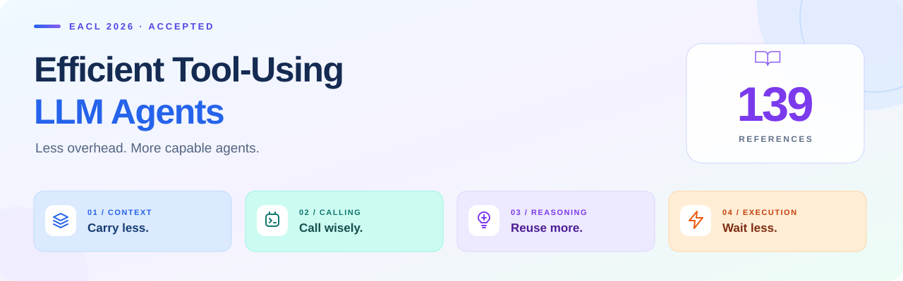
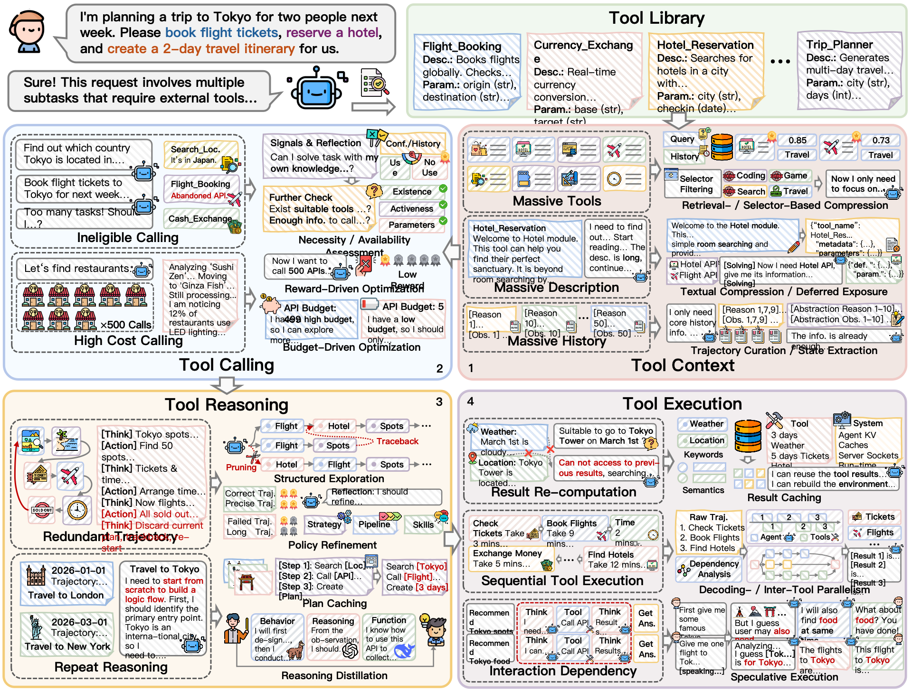

<p align="center">
  
</p>

<h1 align="center">How to Make Tool-Using LLM Agents Efficient?</h1>
<p align="center"><strong>🎉 Accepted at EACL 2026</strong><br>A Survey · A Structured Reading List</p>
<p align="center">
  <a href="https://www.preprints.org/manuscript/202608.0365"></a>
  
  
  
</p>

<p align="center">Yunuo Hu · Ziyang Cheng · Wenqi Pei · Miaomiao Li · Boyan Li · Yizhang Zhu<br>Yupeng Xie · Han Chen · Shizheng Hou · Yuyu Luo · Hongyang Du</p>
<p align="center"><a href="https://www.preprints.org/manuscript/202608.0365">📄 Paper ↗</a> &nbsp; · &nbsp; <a href="#survey-overview">🖼️ Overview</a> &nbsp; · &nbsp; <a href="#reading-list">📚 Reading List</a> &nbsp; · &nbsp; <a href="#citation">📝 Cite This Survey</a></p>

<a id="about"></a>

## 📘 About

Tool-using agents spend resources on context, invocation decisions, reasoning trajectories, and execution. This collection follows the survey's four-stage taxonomy to help researchers locate techniques that reduce that overhead while preserving task performance.

The survey tracks four resources: **tokens**, **tool calls**, **latency**, and **monetary cost**. Improvements across studies use different settings and should not be interpreted as a common performance ranking.

> Preprint: [Version 1, posted 6 August 2026](https://www.preprints.org/manuscript/202608.0365). Literature coverage ends in July 2026. Source snapshot: 13 November 2026.

<a id="survey-overview"></a>

## 🖼️ Survey Overview

<p align="center">
  <a href="figs/meta.png"></a>
</p>
<p align="center"><em>The four stages of efficient tool-using LLM agents. Click the figure to view it at full resolution.</em></p>

<a id="navigation"></a>

## 🧭 Navigation

| Stage | Research question | Entries below |
| :--- | :--- | :---: |
| [🧩 01 · Efficient Tool Context](#efficient-tool-context) | How can an agent carry less context? | 36 |
| [🛠️ 02 · Efficient Tool Calling](#efficient-tool-calling) | When is a tool call worth making? | 18 |
| [🧠 03 · Efficient Tool Reasoning](#efficient-tool-reasoning) | How can an agent reason with less repeated work? | 27 |
| [⚡ 04 · Efficient Tool Execution](#efficient-tool-execution) | How can tools finish with less waiting? | 36 |
| [🌱 Background & Related Work](#background--related-work) | Foundations, benchmarks, surveys, and further directions | 22 |

The classified list includes **117 references discussed in Section 3**, including two industry articles. The paper states that its taxonomy covers 111 works; this repository also retains the additional Section 3 citations so that no cited references are silently omitted. The tables below include **all 139 source entries**, including background and industry references.

**Link key:** `Paper` links to an arXiv identifier present in the bibliography. `Search` opens a title-based Scholar search when a direct paper URL was not extracted. `Code` retains a repository link supplied by Table A1; links are not a guarantee of implementation quality or availability. Years follow the bibliography; venues follow Table A1. `—` means the comparison table does not supply a venue for that entry.

<a id="reading-list"></a>

## 📚 Reading List

<a id="efficient-tool-context"></a>

## 🧩 Efficient Tool Context

### 🗂️ Tool Set Compression

#### Retrieval-Based Compression

| Method | 📄 Paper | 📅 Year | 🏛️ Venue in survey | 🔗 Links |
| :--- | :--- | :---: | :--- | :--- |
| **Dynamic ReAct** | Dynamic react: Scalable tool selection for large-scale mcp environments | 2025 | Preprint 2025 | [Paper](https://arxiv.org/abs/2509.20386) |
| **ToolSEE** | ToolSEE: Agent Tool Search Engine for Efficient and Scalable Tool Discovery Using Retrieval | 2025 | Preprint 2025 | [Search](https://scholar.google.com/scholar?q=ToolSEE%3A%20Agent%20Tool%20Search%20Engine%20for%20Efficient%20and%20Scalable%20Tool%20Discovery%20Using%20Retrieval) · [Code](https://github.com/Pro-GenAI/Tool-SEE) |
| **DTDR** | Dynamic Tool Dependency Retrieval for Efficient Function Calling | 2025 | NFIR @ AAAI 2026 | [Paper](https://arxiv.org/abs/2512.17052) |
| **Graph-of-Skills** | Graph-of-Skills: Dependency-Aware Structural Retrieval for Massive Agent Skills | 2026 | Preprint 2026 | [Search](https://scholar.google.com/scholar?q=Graph-of-Skills%3A%20Dependency-Aware%20Structural%20Retrieval%20for%20Massive%20Agent%20Skills) · [Code](https://github.com/davidliuk/graph-of-skills) |
| **SkillSight** | SkillSight: Calibrating Generic Content Bias for Skill Retrieval | 2026 | Preprint 2026 | [Search](https://scholar.google.com/scholar?q=SkillSight%3A%20Calibrating%20Generic%20Content%20Bias%20for%20Skill%20Retrieval) · [Code](https://github.com/xiaojinying/SkillSight) |

#### Selector-Based Compression

| Method | 📄 Paper | 📅 Year | 🏛️ Venue in survey | 🔗 Links |
| :--- | :--- | :---: | :--- | :--- |
| **ATS** | Automatic Tool Selection to Reduce Large Language Model Latency | 2024 | — | [Search](https://scholar.google.com/scholar?q=Automatic%20Tool%20Selection%20to%20Reduce%20Large%20Language%20Model%20Latency) |
| **GEAR** | Gear: Augmenting language models with generalizable and efficient tool resolution | 2024 | EACL 2024 | [Search](https://scholar.google.com/scholar?q=Gear%3A%20Augmenting%20language%20models%20with%20generalizable%20and%20efficient%20tool%20resolution) · [Code](https://github.com/yining610/GEAR) |
| **NTILC** | NTILC: Neural Tool Invocation via Learned Compression | 2026 | Preprint 2026 | [Search](https://scholar.google.com/scholar?q=NTILC%3A%20Neural%20Tool%20Invocation%20via%20Learned%20Compression) · [Code](https://github.com/andykr1k/NTILC) |
| **AutoTool** | AutoTool: Efficient tool selection for large language model agents | 2026 | AAAI 2026 | [Search](https://scholar.google.com/scholar?q=AutoTool%3A%20Efficient%20tool%20selection%20for%20large%20language%20model%20agents) · [Code](https://github.com/jiajingyyyyyy/AutoTool) |

#### Hierarchical Compression

| Method | 📄 Paper | 📅 Year | 🏛️ Venue in survey | 🔗 Links |
| :--- | :--- | :---: | :--- | :--- |
| **GeckOpt** | Geckopt: Llm system efficiency via intent-based tool selection | 2024 | GLSVLSI 2024 | [Search](https://scholar.google.com/scholar?q=Geckopt%3A%20Llm%20system%20efficiency%20via%20intent-based%20tool%20selection) |
| **SING** | SING: Synthetic Intention Graph for Scalable Active Tool Discovery in LLM Agents | 2026 | Preprint 2026 | [Search](https://scholar.google.com/scholar?q=SING%3A%20Synthetic%20Intention%20Graph%20for%20Scalable%20Active%20Tool%20Discovery%20in%20LLM%20Agents) |
| **Less-is-More** | Less is more: Optimizing function calling for llm execution on edge devices | 2025 | DATE 2025 | [Search](https://scholar.google.com/scholar?q=Less%20is%20more%3A%20Optimizing%20function%20calling%20for%20llm%20execution%20on%20edge%20devices) |
| **SkillLens** | SkillLens: Adaptive Multi-Granularity Skill Reuse for Cost-Efficient LLM Agents | 2026 | Preprint 2026 | [Search](https://scholar.google.com/scholar?q=SkillLens%3A%20Adaptive%20Multi-Granularity%20Skill%20Reuse%20for%20Cost-Efficient%20LLM%20Agents) |

### ✂️ Tool Description Compression

#### Textual Compression

| Method | 📄 Paper | 📅 Year | 🏛️ Venue in survey | 🔗 Links |
| :--- | :--- | :---: | :--- | :--- |
| **EASYTOOL** | Easytool: Enhancing llm-based agents with concise tool instruction | 2025 | NAACL 2025 | [Search](https://scholar.google.com/scholar?q=Easytool%3A%20Enhancing%20llm-based%20agents%20with%20concise%20tool%20instruction) · [Code](https://github.com/microsoft/JARVIS/tree/main/easytool) |
| **Xu et al.** | Concise and precise context compression for tool-using language models | 2024 | ACL 2024 Findings | [Search](https://scholar.google.com/scholar?q=Concise%20and%20precise%20context%20compression%20for%20tool-using%20language%20models) |
| **Shemla et al.** | Internalizing Tool Knowledge in Small Language Models via QLoRA Fine-Tuning | 2026 | Preprint 2026 | [Search](https://scholar.google.com/scholar?q=Internalizing%20Tool%20Knowledge%20in%20Small%20Language%20Models%20via%20QLoRA%20Fine-Tuning) |
| **LatentSkill** | LatentSkill: From In-Context Textual Skills to In-Weight Latent Skills for LLM Agents | 2026 | Preprint 2026 | [Search](https://scholar.google.com/scholar?q=LatentSkill%3A%20From%20In-Context%20Textual%20Skills%20to%20In-Weight%20Latent%20Skills%20for%20LLM%20Agents) · [Code](https://github.com/yuaofan0-oss/LatentSkill) |
| **SKILL0** | SKILL0: In-Context Agentic Reinforcement Learning for Skill Internalization | 2026 | Preprint 2026 | [Search](https://scholar.google.com/scholar?q=SKILL0%3A%20In-Context%20Agentic%20Reinforcement%20Learning%20for%20Skill%20Internalization) · [Code](https://github.com/ZJU-REAL/SkillZero) |

#### Deferred Schema Exposure

| Method | 📄 Paper | 📅 Year | 🏛️ Venue in survey | 🔗 Links |
| :--- | :--- | :---: | :--- | :--- |
| **Vijayvargiya and Lokesh** | Efficient On-Device Agents via Adaptive Context Management | 2025 | Preprint 2025 | [Paper](https://arxiv.org/abs/2511.03728) |
| **SkillReducer** | SkillReducer: Optimizing LLM Agent Skills for Token Efficiency | 2026 | Preprint 2026 | [Search](https://scholar.google.com/scholar?q=SkillReducer%3A%20Optimizing%20LLM%20Agent%20Skills%20for%20Token%20Efficiency) |
| **Code Execution with MCP** | Code Execution with MCP: 98.7% Token Reduction Through Efficient Agent Architecture | 2024 | — | [Search](https://scholar.google.com/scholar?q=Code%20Execution%20with%20MCP%3A%2098.7%25%20Token%20Reduction%20Through%20Efficient%20Agent%20Architecture) |

### 🧹 History Compression

#### Trajectory Curation

| Method | 📄 Paper | 📅 Year | 🏛️ Venue in survey | 🔗 Links |
| :--- | :--- | :---: | :--- | :--- |
| **Smurfs** | Smurfs: Leveraging multiple proficiency agents with context-efficiency for tool planning | 2024 | NAACL 2025 | [Search](https://scholar.google.com/scholar?q=Smurfs%3A%20Leveraging%20multiple%20proficiency%20agents%20with%20context-efficiency%20for%20tool%20planning) · [Code](https://github.com/FreedomIntelligence/Smurfs) |
| **AGORA** | AGORA: Adapter-Grounded Observation-Action Retention for Inference-Free Prompt Compression in LLM Agents | 2026 | Preprint 2026 | [Search](https://scholar.google.com/scholar?q=AGORA%3A%20Adapter-Grounded%20Observation-Action%20Retention%20for%20Inference-Free%20Prompt%20Compression%20in%20LLM%20Agents) · [Code](https://github.com/ranranrannervous/agoracompression) |
| **MemTool** | Memtool: Optimizing short-term memory management for dynamic tool calling in llm agent multi-turn conversations | 2025 | ECIR 2026 | [Paper](https://arxiv.org/abs/2507.21428) |
| **TokenPilot** | TokenPilot: Cache-Efficient Context Management for LLM Agents | 2026 | Preprint 2026 | [Search](https://scholar.google.com/scholar?q=TokenPilot%3A%20Cache-Efficient%20Context%20Management%20for%20LLM%20Agents) · [Code](https://github.com/zjunlp/LightMem2) |
| **Self-GC** | Self-GC: Self-Governing Context for Long-Horizon LLM Agents | 2026 | Preprint 2026 | [Search](https://scholar.google.com/scholar?q=Self-GC%3A%20Self-Governing%20Context%20for%20Long-Horizon%20LLM%20Agents) |
| **MemAct** | Memory as action: Autonomous context curation for long-horizon agentic tasks | 2025 | Preprint 2025 | [Paper](https://arxiv.org/abs/2510.12635) · [Code](https://github.com/ADaM-BJTU/MemAct) |
| **ContextBudget** | ContextBudget: Budget-Aware Context Management for Long-Horizon Search Agents | 2026 | Preprint 2026 | [Search](https://scholar.google.com/scholar?q=ContextBudget%3A%20Budget-Aware%20Context%20Management%20for%20Long-Horizon%20Search%20Agents) |
| **AdaCoM** | Learning Agent-Compatible Context Management for Long-Horizon Tasks | 2026 | — | [Search](https://scholar.google.com/scholar?q=Learning%20Agent-Compatible%20Context%20Management%20for%20Long-Horizon%20Tasks) |

#### State Extraction

| Method | 📄 Paper | 📅 Year | 🏛️ Venue in survey | 🔗 Links |
| :--- | :--- | :---: | :--- | :--- |
| **AgentFold** | AgentFold: Long-Horizon Web Agents with Proactive Context Management | 2025 | ICLR 2026 | [Paper](https://arxiv.org/abs/2510.24699) · [Code](https://github.com/Alibaba-NLP/DeepResearch) |
| **Slipstream** | Slipstream: Trajectory-Grounded Compaction Validation for Long-Horizon Agents | 2026 | Preprint 2026 | [Search](https://scholar.google.com/scholar?q=Slipstream%3A%20Trajectory-Grounded%20Compaction%20Validation%20for%20Long-Horizon%20Agents) · [Code](https://github.com/chenzhuofu/slipstream) |
| **ContextWeaver** | ContextWeaver: Selective and Dependency-Structured Memory Construction for LLM Agents | 2026 | Preprint 2026 | [Search](https://scholar.google.com/scholar?q=ContextWeaver%3A%20Selective%20and%20Dependency-Structured%20Memory%20Construction%20for%20LLM%20Agents) |
| **Xie et al.** | From History to State: Constant-Context Skill Learning for LLM Agents | 2026 | Preprint 2026 | [Search](https://scholar.google.com/scholar?q=From%20History%20to%20State%3A%20Constant-Context%20Skill%20Learning%20for%20LLM%20Agents) |
| **ACON** | Acon: Optimizing context compression for long-horizon llm agents | 2025 | LLA @ ICLR 2026 | [Paper](https://arxiv.org/abs/2510.00615) · [Code](https://github.com/microsoft/acon) |
| **Memex** | Memex(RL): Scaling Long-Horizon LLM Agents via Indexed Experience Memory | 2026 | Preprint 2026 | [Search](https://scholar.google.com/scholar?q=Memex%28RL%29%3A%20Scaling%20Long-Horizon%20LLM%20Agents%20via%20Indexed%20Experience%20Memory) · [Code](https://github.com/Accenture/MemexRL) |
| **PEEK** | PEEK: Context Map as an Orientation Cache for Long-Context LLM Agents | 2026 | Preprint 2026 | [Search](https://scholar.google.com/scholar?q=PEEK%3A%20Context%20Map%20as%20an%20Orientation%20Cache%20for%20Long-Context%20LLM%20Agents) · [Code](https://github.com/zhuohangu/peek) |

[↑ Back to navigation](#navigation)

<a id="efficient-tool-calling"></a>

## 🛠️ Efficient Tool Calling

### ✅ Eligibility-Aware Calling

#### Necessity Assessment

| Method | 📄 Paper | 📅 Year | 🏛️ Venue in survey | 🔗 Links |
| :--- | :--- | :---: | :--- | :--- |
| **SMARTCAL** | Smartcal: An approach to self-aware tool-use evaluation and calibration | 2024 | EMNLP 2024 | [Search](https://scholar.google.com/scholar?q=Smartcal%3A%20An%20approach%20to%20self-aware%20tool-use%20evaluation%20and%20calibration) · [Code](https://github.com/Henrysyh2000/SMARTCAL) |
| **SMART** | SMART: Self-aware agent for tool overuse mitigation | 2025 | ACL 2025 Findings | [Search](https://scholar.google.com/scholar?q=SMART%3A%20Self-aware%20agent%20for%20tool%20overuse%20mitigation) · [Code](https://github.com/qiancheng0/Open-SMARTAgent) |
| **Probe&Prefill** | LLM Agents Already Know When to Call Tools – Even Without Reasoning | 2026 | Preprint 2026 | [Search](https://scholar.google.com/scholar?q=LLM%20Agents%20Already%20Know%20When%20to%20Call%20Tools%20%E2%80%93%20Even%20Without%20Reasoning) · [Code](https://github.com/Trustworthy-ML-Lab/when2tool) |
| **MeCo** | Adaptive tool use in large language models with meta-cognition trigger | 2025 | ACL 2025 | [Search](https://scholar.google.com/scholar?q=Adaptive%20tool%20use%20in%20large%20language%20models%20with%20meta-cognition%20trigger) |
| **SKT-Tool** | Self Knowledge-Tracing for Tool Use (SKT-Tool): Helping LLM Agents Understand Their Capabilities in Tool Use | 2025 | Insights @ ACL 2025 | [Search](https://scholar.google.com/scholar?q=Self%20Knowledge-Tracing%20for%20Tool%20Use%20%28SKT-Tool%29%3A%20Helping%20LLM%20Agents%20Understand%20Their%20Capabilities%20in%20Tool%20Use) |

#### Availability Assessment

| Method | 📄 Paper | 📅 Year | 🏛️ Venue in survey | 🔗 Links |
| :--- | :--- | :---: | :--- | :--- |
| **DEER** | Look before you leap: towards decision-aware and generalizable tool-usage for large language models | 2024 | Preprint 2024 | [Paper](https://arxiv.org/abs/2402.16696) · [Code](https://github.com/Ericmututu/ToolDEER) |
| **When2Call** | When2Call: When (not) to call tools | 2025 | NAACL 2025 | [Search](https://scholar.google.com/scholar?q=When2Call%3A%20When%20%28not%29%20to%20call%20tools) · [Code](https://github.com/NVIDIA/When2Call) |
| **KBA** | Knowledge Base-Aware Orchestration: A Dynamic, Privacy-Preserving Method for Multi-Agent Systems | 2025 | Preprint 2025 | [Paper](https://arxiv.org/abs/2509.19599) |

### 💰 Cost-Aware Calling

#### Reward-Driven Optimization

| Method | 📄 Paper | 📅 Year | 🏛️ Venue in survey | 🔗 Links |
| :--- | :--- | :---: | :--- | :--- |
| **AutoTIR** | Autotir: Autonomous tools integrated reasoning via reinforcement learning | 2025 | Preprint 2025 | [Paper](https://arxiv.org/abs/2507.21836) · [Code](https://github.com/weiyifan1023/AutoTIR) |
| **OTC-PO** | Acting Less is Reasoning More! Teaching Language Model to Act Efficiently | 2025 | LAW @ NeurIPS 2025 | [Search](https://scholar.google.com/scholar?q=Acting%20Less%20is%20Reasoning%20More%21%20Teaching%20Language%20Model%20to%20Act%20Efficiently) |
| **Xu et al.** | Alignment for efficient tool calling of large language models | 2025 | EMNLP 2025 | [Search](https://scholar.google.com/scholar?q=Alignment%20for%20efficient%20tool%20calling%20of%20large%20language%20models) |
| **AdaTIR** | AdaTIR: Adaptive Tool-Integrated Reasoning via Difficulty-Aware Policy Optimization | 2026 | Preprint 2026 | [Paper](https://arxiv.org/abs/2601.14696) |
| **LQM-ContextRoute** | Latency-Quality Routing for Functionally Equivalent Tools in LLM Agents | 2026 | Preprint 2026 | [Search](https://scholar.google.com/scholar?q=Latency-Quality%20Routing%20for%20Functionally%20Equivalent%20Tools%20in%20LLM%20Agents) |

#### Budget-Driven Optimization

| Method | 📄 Paper | 📅 Year | 🏛️ Venue in survey | 🔗 Links |
| :--- | :--- | :---: | :--- | :--- |
| **BTP** | Budget-constrained tool learning with planning | 2024 | ACL 2024 Findings | [Search](https://scholar.google.com/scholar?q=Budget-constrained%20tool%20learning%20with%20planning) · [Code](https://github.com/THUNLP-MT/BTP) |
| **Wang** | A Stackelberg Framework for Resource-Aware LLM Agents: Learning, Repair, and Conditional Guarantees | 2026 | Preprint 2026 | [Search](https://scholar.google.com/scholar?q=A%20Stackelberg%20Framework%20for%20Resource-Aware%20LLM%20Agents%3A%20Learning%2C%20Repair%2C%20and%20Conditional%20Guarantees) |
| **BATS** | Budget-aware tool-use enables effective agent scaling | 2025 | Preprint 2025 | [Paper](https://arxiv.org/abs/2511.17006) |
| **MASH** | MASH: Modeling Abstention via Selective Help-Seeking | 2026 | Preprint 2025 | [Search](https://scholar.google.com/scholar?q=MASH%3A%20Modeling%20Abstention%20via%20Selective%20Help-Seeking) · [Code](https://github.com/momergul/mash) |
| **INTENT** | Budget-Constrained Agentic Large Language Models: Intention-Based Planning for Costly Tool Use | 2026 | Preprint 2026 | [Paper](https://arxiv.org/abs/2602.11541) |

[↑ Back to navigation](#navigation)

<a id="efficient-tool-reasoning"></a>

## 🧠 Efficient Tool Reasoning

### 🎯 Trajectory Optimization

#### Structured Exploration

| Method | 📄 Paper | 📅 Year | 🏛️ Venue in survey | 🔗 Links |
| :--- | :--- | :---: | :--- | :--- |
| **ToolChain\*** | Toolchain\*: Efficient action space navigation in large language models with a\* search | 2023 | ICLR 2024 | [Paper](https://arxiv.org/abs/2310.13227) |
| **Tree-Planner** | Tree-planner: Efficient close-loop task planning with large language models | 2023 | ICLR 2024 | [Paper](https://arxiv.org/abs/2310.08582) · [Code](https://github.com/Aaron617/tree-planner) |
| **ToolPlanner** | Toolplanner: A tool augmented llm for multi granularity instructions with path planning and feedback | 2024 | EMNLP 2024 | [Search](https://scholar.google.com/scholar?q=Toolplanner%3A%20A%20tool%20augmented%20llm%20for%20multi%20granularity%20instructions%20with%20path%20planning%20and%20feedback) · [Code](https://github.com/XiaoMi/toolplanner) |
| **T²Agent** | T2Agent: A Tool-augmented Multimodal Misinformation Detection Agent with Monte Carlo Tree Search | 2026 | AAAI 2026 | [Search](https://scholar.google.com/scholar?q=T2Agent%3A%20A%20Tool-augmented%20Multimodal%20Misinformation%20Detection%20Agent%20with%20Monte%20Carlo%20Tree%20Search) · [Code](https://github.com/cuixing100876/T2Agent) |
| **ToolTree** | ToolTree: Efficient LLM Agent Tool Planning via Dual-Feedback Monte Carlo Tree Search and Bidirectional Pruning | 2026 | ICLR 2026 | [Paper](https://arxiv.org/abs/2603.12740) · [Code](https://github.com/SYang2000/ICLR_2026_ToolTree/tree/main) |
| **BAVT** | Spend Less, Reason Better: Budget-Aware Value Tree Search for LLM Agents | 2026 | Preprint 2026 | [Search](https://scholar.google.com/scholar?q=Spend%20Less%2C%20Reason%20Better%3A%20Budget-Aware%20Value%20Tree%20Search%20for%20LLM%20Agents) |
| **EGB** | Long-Horizon Plan Execution in Large Tool Spaces through Entropy-Guided Branching | 2026 | Preprint 2026 | [Search](https://scholar.google.com/scholar?q=Long-Horizon%20Plan%20Execution%20in%20Large%20Tool%20Spaces%20through%20Entropy-Guided%20Branching) |
| **Agent JIT Compilation** | Agent JIT Compilation for Latency-Optimizing Web Agent Planning and Scheduling | 2026 | ICML 2026 | [Search](https://scholar.google.com/scholar?q=Agent%20JIT%20Compilation%20for%20Latency-Optimizing%20Web%20Agent%20Planning%20and%20Scheduling) |
| **AgentStop** | AgentStop: Terminating Local AI Agents Early to Save Energy in Consumer Devices | 2026 | CAIS 2026 | [Search](https://scholar.google.com/scholar?q=AgentStop%3A%20Terminating%20Local%20AI%20Agents%20Early%20to%20Save%20Energy%20in%20Consumer%20Devices) · [Code](https://github.com/brave-experiments/AgentStop) |
| **Ruan et al.** | Doomed from the Start: Early Abort of LLM Agent Episodes via a Recall-Controlled Probe Cascade | 2026 | Preprint 2026 | [Search](https://scholar.google.com/scholar?q=Doomed%20from%20the%20Start%3A%20Early%20Abort%20of%20LLM%20Agent%20Episodes%20via%20a%20Recall-Controlled%20Probe%20Cascade) |

#### Policy Refinement

| Method | 📄 Paper | 📅 Year | 🏛️ Venue in survey | 🔗 Links |
| :--- | :--- | :---: | :--- | :--- |
| **ToolPrefer-LLaMA** | Advancing tool-augmented large language models: Integrating insights from errors in inference trees | 2024 | NeurIPS 2024 | [Search](https://scholar.google.com/scholar?q=Advancing%20tool-augmented%20large%20language%20models%3A%20Integrating%20insights%20from%20errors%20in%20inference%20trees) |
| **Tool-MVR** | Advancing tool-augmented large language models via meta-verification and reflection learning | 2025 | KDD 2025 | [Search](https://scholar.google.com/scholar?q=Advancing%20tool-augmented%20large%20language%20models%20via%20meta-verification%20and%20reflection%20learning) · [Code](https://github.com/zhymma/Tool-MVR) |
| **ET-Agent** | ET-Agent: Incentivizing Effective Tool-Integrated Reasoning Agent via Behavior Calibration | 2026 | ACL 2026 | [Paper](https://arxiv.org/abs/2601.06860) · [Code](https://github.com/RUC-NLPIR/ET-Agent) |
| **CodeTool** | Codetool: Enhancing programmatic tool invocation of llms via process supervision | 2025 | ACL 2025 | [Paper](https://arxiv.org/abs/2503.20840) · [Code](https://github.com/LimOkii/CodeTool) |
| **Ares** | Ares: Adaptive Reasoning Effort Selection for Efficient LLM Agents | 2026 | Preprint 2026 | [Search](https://scholar.google.com/scholar?q=Ares%3A%20Adaptive%20Reasoning%20Effort%20Selection%20for%20Efficient%20LLM%20Agents) · [Code](https://github.com/UCSB-NLP-Chang/Ares) |
| **Wu et al. 2025** | A joint optimization framework for enhancing efficiency of tool utilization in llm agents | 2025 | ACL 2025 | [Search](https://scholar.google.com/scholar?q=A%20joint%20optimization%20framework%20for%20enhancing%20efficiency%20of%20tool%20utilization%20in%20llm%20agents) · [Code](https://github.com/Bingo-W/ToolOptimization) |

### ♻️ Reasoning Reuse

#### Plan Caching

| Method | 📄 Paper | 📅 Year | 🏛️ Venue in survey | 🔗 Links |
| :--- | :--- | :---: | :--- | :--- |
| **AgentReuse** | A Plan Reuse Mechanism for LLM-Driven Agent | 2024 | JCRD 2024 | [Search](https://scholar.google.com/scholar?q=A%20Plan%20Reuse%20Mechanism%20for%20LLM-Driven%20Agent) |
| **AgenticCache** | AgenticCache: Cache-Driven Asynchronous Planning for Embodied AI Agents | 2026 | MLSys 2026 | [Search](https://scholar.google.com/scholar?q=AgenticCache%3A%20Cache-Driven%20Asynchronous%20Planning%20for%20Embodied%20AI%20Agents) · [Code](https://github.com/hojoonleokim/MLSys26_AgenticCache) |
| **APC** | Agentic Plan Caching: Test-Time Memory for Fast and Cost-Efficient LLM Agents | 2025 | NeurIPS 2025 | [Paper](https://arxiv.org/abs/2506.14852) |
| **SemanticALLI** | SemanticALLI: Caching Reasoning, Not Just Responses, in Agentic Systems | 2026 | Preprint 2026 | [Paper](https://arxiv.org/abs/2601.16286) |
| **SkillMigrator** | Beyond Domains: Reusing Web Skills via Transferable Interaction Patterns | 2026 | Preprint 2026 | [Search](https://scholar.google.com/scholar?q=Beyond%20Domains%3A%20Reusing%20Web%20Skills%20via%20Transferable%20Interaction%20Patterns) |
| **EvoSOP** | From Atomic Actions to Standard Operating Procedures: Iterative Tool Optimization for Self-Evolving LLM Agents | 2026 | Preprint 2026 | [Search](https://scholar.google.com/scholar?q=From%20Atomic%20Actions%20to%20Standard%20Operating%20Procedures%3A%20Iterative%20Tool%20Optimization%20for%20Self-Evolving%20LLM%20Agents) |
| **Tool-Making** | Tool-Making and Self-Evolving LLM Agents in Low-Latency Systems | 2026 | Preprint 2026 | [Paper](https://arxiv.org/abs/2607.08010) |

#### Reasoning Distillation

| Method | 📄 Paper | 📅 Year | 🏛️ Venue in survey | 🔗 Links |
| :--- | :--- | :---: | :--- | :--- |
| **Agent Distillation** | Distilling llm agent into small models with retrieval and code tools | 2025 | NeurIPS 2025 | [Paper](https://arxiv.org/abs/2505.17612) · [Code](https://github.com/Nardien/agent-distillation) |
| **TinyAgent** | Tinyagent: Function calling at the edge | 2024 | EMNLP 2024 | [Search](https://scholar.google.com/scholar?q=Tinyagent%3A%20Function%20calling%20at%20the%20edge) · [Code](https://github.com/SqueezeAILab/TinyAgent) |
| **ODIA** | ODIA: Oriented Distillation for Inline Acceleration of LLM-based Function Calling | 2025 | Preprint 2025 | [Paper](https://arxiv.org/abs/2507.08877) |
| **AgentDistill** | Agentdistill: Training-free agent distillation with generalizable mcp boxes | 2025 | Preprint 2025 | [Paper](https://arxiv.org/abs/2506.14728) · [Code](https://github.com/shimu0215/AgentDistill) |

[↑ Back to navigation](#navigation)

<a id="efficient-tool-execution"></a>

## ⚡ Efficient Tool Execution

### 💾 Results Caching

#### Tool-Level Caching

| Method | 📄 Paper | 📅 Year | 🏛️ Venue in survey | 🔗 Links |
| :--- | :--- | :---: | :--- | :--- |
| **GPTCache** | Gptcache: An open-source semantic cache for llm applications enabling faster answers and cost savings | 2023 | NLP-OSS 2023 | [Search](https://scholar.google.com/scholar?q=Gptcache%3A%20An%20open-source%20semantic%20cache%20for%20llm%20applications%20enabling%20faster%20answers%20and%20cost%20savings) · [Code](https://github.com/zilliztech/gptcache) |
| **LLM-dCache** | Llm-dcache: improving tool-augmented llms with gpt-driven localized data caching | 2024 | ICECS 2024 | [Paper](https://arxiv.org/abs/2406.06799) |
| **Tool Cache Agent** | Tool Cache Agent: Accelerating LLM Agent Through Intelligent Tool Call Caching | 2025 | Preprint 2025 | [Search](https://scholar.google.com/scholar?q=Tool%20Cache%20Agent%3A%20Accelerating%20LLM%20Agent%20Through%20Intelligent%20Tool%20Call%20Caching) |
| **ToolCaching** | ToolCaching: Towards Efficient Caching for LLM Tool-calling | 2026 | Preprint 2026 | [Paper](https://arxiv.org/abs/2601.15335) |
| **Cortex** | Cortex: Achieving {Low-Latency},{Cost-Efficient} Remote Data Access For {LLM} via {Semantic-Aware} Knowledge Caching | 2026 | NSDI 2026 | [Search](https://scholar.google.com/scholar?q=Cortex%3A%20Achieving%20%7BLow-Latency%7D%2C%7BCost-Efficient%7D%20Remote%20Data%20Access%20For%20%7BLLM%7D%20via%20%7BSemantic-Aware%7D%20Knowledge%20Caching) |
| **DSG** | Decoupling Search from Reasoning: A Vendor-Agnostic Grounding Architecture for LLM Agents | 2026 | Preprint 2026 | [Search](https://scholar.google.com/scholar?q=Decoupling%20Search%20from%20Reasoning%3A%20A%20Vendor-Agnostic%20Grounding%20Architecture%20for%20LLM%20Agents) |

#### System-Level Caching

| Method | 📄 Paper | 📅 Year | 🏛️ Venue in survey | 🔗 Links |
| :--- | :--- | :---: | :--- | :--- |
| **TVCache** | TVCACHE: A Stateful Tool-Value Cache for Post-Training LLM Agents | 2026 | Preprint 2026 | [Paper](https://arxiv.org/abs/2602.10986) · [Code](https://github.com/TVCache/TVCache) |
| **FAME** | Optimizing FaaS Platforms for MCP-enabled Agentic Workflows | 2026 | Preprint 2026 | [Paper](https://arxiv.org/abs/2601.14735) |
| **Merchant et al. 2026** | Evaluating Temporal Semantic Caching and Workflow Optimization in Agentic Plan-Execute Pipelines | 2026 | Preprint 2026 | [Search](https://scholar.google.com/scholar?q=Evaluating%20Temporal%20Semantic%20Caching%20and%20Workflow%20Optimization%20in%20Agentic%20Plan-Execute%20Pipelines) |

### 🔀 Parallel Execution

#### Decoding-Tool Parallelism

| Method | 📄 Paper | 📅 Year | 🏛️ Venue in survey | 🔗 Links |
| :--- | :--- | :---: | :--- | :--- |
| **CoA** | Efficient tool use with chain-of-abstraction reasoning | 2025 | COLING 2025 | [Search](https://scholar.google.com/scholar?q=Efficient%20tool%20use%20with%20chain-of-abstraction%20reasoning) · [Code](https://github.com/Silin159/CoA) |
| **Conveyor** | Conveyor: Efficient tool-aware llm serving with tool partial execution | 2024 | Preprint 2024 | [Paper](https://arxiv.org/abs/2406.00059) · [Code](https://github.com/conveyor-sys/conveyor) |
| **ToolSpec** | ToolSpec: Accelerating Tool Calling via Schema-Aware and Retrieval-Augmented Speculative Decoding | 2026 | Preprint 2026 | [Search](https://scholar.google.com/scholar?q=ToolSpec%3A%20Accelerating%20Tool%20Calling%20via%20Schema-Aware%20and%20Retrieval-Augmented%20Speculative%20Decoding) · [Code](https://github.com/hemingkx/ToolSpec) |
| **AsyncLM** | Asynchronous llm function calling | 2024 | Preprint 2024 | [Paper](https://arxiv.org/abs/2412.07017) |
| **AsyncFC** | Concurrency without Model Changes: Future-based Asynchronous Function Calling for LLMs | 2026 | Preprint 2026 | [Search](https://scholar.google.com/scholar?q=Concurrency%20without%20Model%20Changes%3A%20Future-based%20Asynchronous%20Function%20Calling%20for%20LLMs) |
| **IdleSpec** | IdleSpec: Exploiting Idle Time via Speculative Planning for LLM Agents | 2026 | Preprint 2026 | [Search](https://scholar.google.com/scholar?q=IdleSpec%3A%20Exploiting%20Idle%20Time%20via%20Speculative%20Planning%20for%20LLM%20Agents) |
| **Sutradhara** | Sutradhara: An Intelligent Orchestrator-Engine Co-design for Tool-based Agentic Inference | 2026 | ASPLOS 2026 | [Paper](https://arxiv.org/abs/2601.12967) |
| **GhostShell** | GhostShell: Streaming LLM Function Calls for Concurrent Embodied Programming | 2025 | Preprint 2025 | [Paper](https://arxiv.org/abs/2508.05298) · [Code](https://github.com/Coco-Robot/GhostShell) |

#### Inter-Tool Parallelism

| Method | 📄 Paper | 📅 Year | 🏛️ Venue in survey | 🔗 Links |
| :--- | :--- | :---: | :--- | :--- |
| **LLMCompiler** | An llm compiler for parallel function calling | 2024 | ICML 2024 | [Search](https://scholar.google.com/scholar?q=An%20llm%20compiler%20for%20parallel%20function%20calling) · [Code](https://github.com/SqueezeAILab/LLMCompiler) |
| **LLM-Tool Compiler** | An llm-tool compiler for fused parallel function calling | 2024 | — | [Paper](https://arxiv.org/abs/2405.17438) |
| **LLMOrch** | Efficient Function Orchestration for Large Language Models | 2025 | IEEE TSE 2026 | [Search](https://scholar.google.com/scholar?q=Efficient%20Function%20Orchestration%20for%20Large%20Language%20Models) |
| **CATP-LLM** | Catp-llm: Empowering large language models for cost-aware tool planning | 2025 | ICCV 2025 | [Search](https://scholar.google.com/scholar?q=Catp-llm%3A%20Empowering%20large%20language%20models%20for%20cost-aware%20tool%20planning) · [Code](https://github.com/duowuyms/OpenCATP-LLM) |
| **GAP** | GAP: Graph-Based Agent Planning with Parallel Tool Use and Reinforcement Learning | 2025 | NORA @ NeurIPS 2025 | [Paper](https://arxiv.org/abs/2510.25320) · [Code](https://github.com/WJQ7777/Graph-Agent-Planning) |
| **DTA-Llama** | Divide-then-aggregate: An efficient tool learning method via parallel tool invocation | 2025 | ACL 2025 | [Search](https://scholar.google.com/scholar?q=Divide-then-aggregate%3A%20An%20efficient%20tool%20learning%20method%20via%20parallel%20tool%20invocation) · [Code](https://github.com/Zhudongsheng75/Divide-Then-Aggregate) |
| **FLASH-SEARCHER** | Flash-searcher: Fast and effective web agents via dag-based parallel execution | 2025 | ICLR 2026 | [Paper](https://arxiv.org/abs/2509.25301) · [Code](https://github.com/OPPO-PersonalAI/Flash-Searcher) |
| **RETO** | Robust and Efficient Tool Orchestration via Layered Execution Structures with Reflective Correction | 2026 | Preprint 2026 | [Paper](https://arxiv.org/abs/2602.18968) |

### 🚀 Speculative Execution

#### Action-Level Speculation

| Method | 📄 Paper | 📅 Year | 🏛️ Venue in survey | 🔗 Links |
| :--- | :--- | :---: | :--- | :--- |
| **Speculative Actions** | Speculative Actions: A Lossless Framework for Faster Agentic Systems | 2025 | ICLR 2026 | [Search](https://scholar.google.com/scholar?q=Speculative%20Actions%3A%20A%20Lossless%20Framework%20for%20Faster%20Agentic%20Systems) · [Code](https://github.com/naimengye/speculative-action) |
| **Speculate with Memory** | Speculate with Memory: Lossless Acceleration for LLM Agents | 2026 | Preprint 2026 | [Search](https://scholar.google.com/scholar?q=Speculate%20with%20Memory%3A%20Lossless%20Acceleration%20for%20LLM%20Agents) |
| **SPORK** | SPORK: Self-Speculative Forking to Accelerate Agentic LLM Inference | 2026 | Preprint 2026 | [Search](https://scholar.google.com/scholar?q=SPORK%3A%20Self-Speculative%20Forking%20to%20Accelerate%20Agentic%20LLM%20Inference) · [Code](https://github.com/baihuajun24/spork) |
| **Speculative Interaction Agents** | Speculative Interaction Agents: Building Real-Time Agents with Asynchronous I/O and Speculative Tool Calling | 2026 | Preprint 2026 | [Search](https://scholar.google.com/scholar?q=Speculative%20Interaction%20Agents%3A%20Building%20Real-Time%20Agents%20with%20Asynchronous%20I/O%20and%20Speculative%20Tool%20Calling) |
| **SPAgent** | Reducing Latency of LLM Search Agent via Speculation-based Algorithm-System Co-Design | 2025 | Preprint 2025 | [Paper](https://arxiv.org/abs/2511.20048) |

#### System-Level Speculation

| Method | 📄 Paper | 📅 Year | 🏛️ Venue in survey | 🔗 Links |
| :--- | :--- | :---: | :--- | :--- |
| **Speculative Tool Calls** | Optimizing Agentic Language Model Inference via Speculative Tool Calls | 2025 | — | [Paper](https://arxiv.org/abs/2512.15834) |
| **SpecCache** | What Limits Agentic Systems Efficiency? | 2025 | SEA @ NeurIPS 2025 | [Paper](https://arxiv.org/abs/2510.16276) · [Code](https://github.com/Waterpine/SpecCache) |
| **Skim** | Skim: Speculative Execution for Fast and Efficient Web Agents | 2026 | Preprint 2026 | [Search](https://scholar.google.com/scholar?q=Skim%3A%20Speculative%20Execution%20for%20Fast%20and%20Efficient%20Web%20Agents) |
| **Stream RAG** | Stream rag: Instant and accurate spoken dialogue systems with streaming tool usage | 2025 | Preprint 2025 | [Paper](https://arxiv.org/abs/2510.02044) |
| **Speculative Tool Calls (industry)** | Break chatbot speed limits with speculative tool calls | 2025 | — | [Search](https://scholar.google.com/scholar?q=Break%20chatbot%20speed%20limits%20with%20speculative%20tool%20calls) |
| **Speculative Tool Calling (industry)** | Speculative tool calling: How to build sub-second voice agents | 2025 | — | [Search](https://scholar.google.com/scholar?q=Speculative%20tool%20calling%3A%20How%20to%20build%20sub-second%20voice%20agents) |

[↑ Back to navigation](#navigation)

<a id="background--related-work"></a>

## 🌱 Background & Related Work

| Method | 📄 Paper | 📅 Year | 🏛️ Venue in survey | 🔗 Links |
| :--- | :--- | :---: | :--- | :--- |
| **React** | React: Synergizing reasoning and acting in language models | 2022 | — | [Search](https://scholar.google.com/scholar?q=React%3A%20Synergizing%20reasoning%20and%20acting%20in%20language%20models) |
| **Toolformer** | Toolformer: Language models can teach themselves to use tools | 2023 | — | [Search](https://scholar.google.com/scholar?q=Toolformer%3A%20Language%20models%20can%20teach%20themselves%20to%20use%20tools) |
| **Gorilla** | Gorilla: Large language model connected with massive apis | 2024 | — | [Search](https://scholar.google.com/scholar?q=Gorilla%3A%20Large%20language%20model%20connected%20with%20massive%20apis) |
| **Webgpt** | Webgpt: Browser-assisted question-answering with human feedback | 2021 | — | [Paper](https://arxiv.org/abs/2112.09332) |
| **MRKL Systems** | MRKL Systems: A modular, neuro-symbolic architecture that combines large language models, external knowledge sources and discrete reasoning | 2022 | — | [Paper](https://arxiv.org/abs/2205.00445) |
| **Pal** | Pal: Program-aided language models | 2023 | — | [Search](https://scholar.google.com/scholar?q=Pal%3A%20Program-aided%20language%20models) |
| **Toolsandbox** | Toolsandbox: A stateful, conversational, interactive evaluation benchmark for llm tool use capabilities | 2025 | — | [Search](https://scholar.google.com/scholar?q=Toolsandbox%3A%20A%20stateful%2C%20conversational%2C%20interactive%20evaluation%20benchmark%20for%20llm%20tool%20use%20capabilities) |
| **Rethinking Stateful Tool Use in Multi-Turn Dialogues** | Rethinking Stateful Tool Use in Multi-Turn Dialogues: Benchmarks and Challenges | 2025 | — | [Search](https://scholar.google.com/scholar?q=Rethinking%20Stateful%20Tool%20Use%20in%20Multi-Turn%20Dialogues%3A%20Benchmarks%20and%20Challenges) |
| **The berkeley function calling leaderboard (bfcl)** | The berkeley function calling leaderboard (bfcl): From tool use to agentic evaluation of large language models | 2025 | — | [Search](https://scholar.google.com/scholar?q=The%20berkeley%20function%20calling%20leaderboard%20%28bfcl%29%3A%20From%20tool%20use%20to%20agentic%20evaluation%20of%20large%20language%20models) |
| **Ghoshal et al.** | When Do Tools and Planning Help LLMs Think? A Cost-and Latency-Aware Benchmark | 2026 | — | [Paper](https://arxiv.org/abs/2601.02663) |
| **Mcpverse** | Mcpverse: An expansive, real-world benchmark for agentic tool use | 2025 | — | [Paper](https://arxiv.org/abs/2508.16260) |
| **Anytool** | Anytool: Self-reflective, hierarchical agents for large-scale api calls | 2024 | — | [Paper](https://arxiv.org/abs/2402.04253) |
| **Parallel Tool Calling** | Why Parallel Tool Calling Matters for LLM Agents | 2026 | — | [Search](https://scholar.google.com/scholar?q=Why%20Parallel%20Tool%20Calling%20Matters%20for%20LLM%20Agents) |
| **HyperAgents** | Hyperagents | 2026 | — | [Search](https://scholar.google.com/scholar?q=Hyperagents) |
| **Wang et al.** | A survey on large language model based autonomous agents | 2024 | — | [Search](https://scholar.google.com/scholar?q=A%20survey%20on%20large%20language%20model%20based%20autonomous%20agents) |
| **Large language model based multi-agents** | Large language model based multi-agents: A survey of progress and challenges | 2024 | — | [Paper](https://arxiv.org/abs/2402.01680) |
| **Large language model agent** | Large language model agent: A survey on methodology, applications and challenges | 2025 | — | [Paper](https://arxiv.org/abs/2503.21460) |
| **Tool learning with large language models** | Tool learning with large language models: A survey | 2025 | — | [Search](https://scholar.google.com/scholar?q=Tool%20learning%20with%20large%20language%20models%3A%20A%20survey) |
| **Yehudai et al.** | Survey on evaluation of llm-based agents | 2025 | — | [Paper](https://arxiv.org/abs/2503.16416) |
| **Du et al.** | A survey on the optimization of large language model-based agents | 2026 | — | [Search](https://scholar.google.com/scholar?q=A%20survey%20on%20the%20optimization%20of%20large%20language%20model-based%20agents) |
| **Toward Efficient Agents** | Toward Efficient Agents: Memory, Tool learning, and Planning | 2026 | — | [Paper](https://arxiv.org/abs/2601.14192) |
| **ToolLLM** | ToolLLM: Facilitating Large Language Models to Master 16000+ Real-world APIs | 2023 | — | [Paper](https://arxiv.org/abs/2307.16789) |

<a id="source-notes"></a>

## 🔎 Source Notes

- CATP-LLM and GAP have empty inline citations in the source narrative. Their bibliography entries are matched by method title (references 116 and 117).
- The source prose cites “Curtis (2025)” while reference 1 reads “Kurtis, L. K. (2025)”; both forms are preserved in the provenance notes.
- MASH is labeled “Preprint 2025” in Table A1, but its bibliography year is 2026. The list uses 2026.
- The source-provided TokenPilot repository resolves to a differently branded project; verify it before treating it as the official implementation. The AutoTIR repository fetch timed out during preparation; its source-provided URL is retained.
- Several bibliography entries contain incomplete arXiv identifiers (`arXiv:cs`). No replacement identifiers or publication claims have been invented. Titles, years, and venues are transcribed from this survey rather than independently audited for every paper.
- Resources mentioned without numbered references, such as some benchmarks in Appendix F, are not counted among the 139 references. OpenClaw is linked as a [source footnote](https://github.com/openclaw/openclaw).

<a id="citation"></a>

## 📝 Citation

```bibtex
@misc{hu2026efficienttoolagents,
  title   = {How to Make Tool-Using LLM Agents Efficient? A Survey},
  author  = {Hu, Yunuo and Cheng, Ziyang and Pei, Wenqi and Li, Miaomiao
             and Li, Boyan and Zhu, Yizhang and Xie, Yupeng and Chen, Han
             and Hou, Shizheng and Luo, Yuyu and Du, Hongyang},
  year    = {2026},
  note    = {Preprints.org, Version 1, posted 6 August 2026},
  url     = {https://www.preprints.org/manuscript/202608.0365}
}
```

<a id="contributing"></a>

## 🤝 Contributing

Corrections and additions are welcome. Include the paper title, stable URL, year, relevant taxonomy branch, and an official code link where available. For corrections to the source snapshot, provide the source reference number. Keep newly suggested papers distinct from the Version 1 bibliography.

The structured records live in [`data/papers.json`](data/papers.json), with taxonomy membership in [`data/taxonomy.json`](data/taxonomy.json). Regenerate this page after editing them:

```sh
python3 scripts/build_readme.py
```

<a id="attribution"></a>

## 💛 Attribution

Taxonomy and bibliographic information are adapted from **Hu et al., “How to Make Tool-Using LLM Agents Efficient? A Survey,” Preprints.org, Version 1 (2026)**, available under [CC BY 4.0](https://creativecommons.org/licenses/by/4.0/). This repository reorganizes that information and adds navigation, link labels, and provenance notes. Linked papers and code remain subject to their respective licenses.
